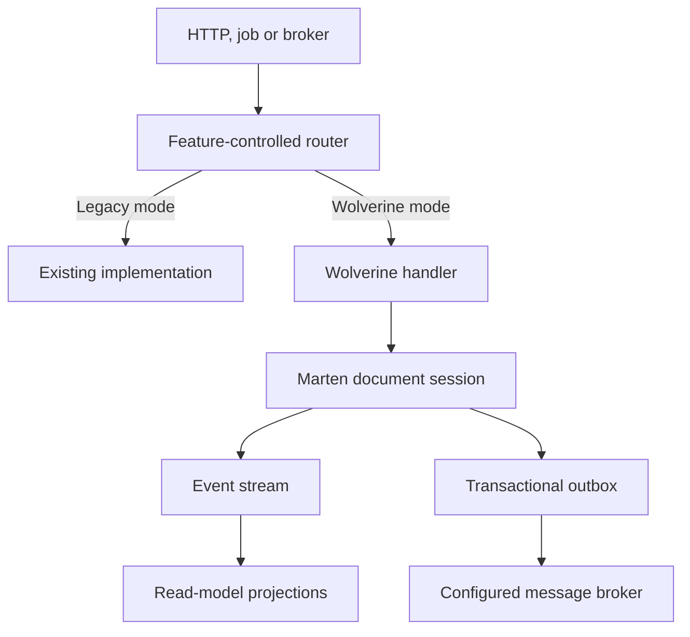

# Wolverine Adoption Specification

**Status:** Proposed  
**Audience:** Application architects, .NET developers, DevOps/SRE, QA  
**Decision scope:** Introduce Wolverine into an existing .NET application behind feature-controlled routing for event-driven messaging and event sourcing  
**Primary technologies:** Wolverine, Marten, PostgreSQL, Microsoft.FeatureManagement

## 1. Purpose

Add Wolverine to the existing application without requiring a big-bang replacement of the current messaging or persistence implementation.

The implementation shall:

1. Preserve the existing production path while Wolverine is disabled.
2. Enable controlled rollout by environment, message type, endpoint, tenant, or aggregate identifier.
3. Use Wolverine for event-driven commands and integration events.
4. Use Marten with Wolverine for event-sourced aggregates and projections.
5. Guarantee that event-stream changes and outgoing messages are committed atomically through the Marten/Wolverine transactional outbox.
6. Provide rapid rollback without losing accepted commands or committed events.
7. Prevent duplicate business effects during migration.

## 2. Assumptions

- The existing application runs on a currently supported .NET version and uses dependency injection and `IHost`/ASP.NET Core hosting.
- The legacy messaging path must remain operational during migration.
- PostgreSQL is acceptable for Marten event storage. If PostgreSQL cannot be adopted, Marten-based event sourcing is out of scope and a separate decision is required.
- The application may use RabbitMQ, Azure Service Bus, AWS SNS/SQS, or Confluent Kafka. Amazon EventBridge integration will use EventBridge-to-SQS routing for inbound events and a small AWS SDK adapter for direct outbound publishing.
- At-least-once delivery is expected. Consumers must therefore be idempotent.
- Existing database records will not automatically be treated as a complete historical event stream.

## 3. Goals and non-goals

### 3.1 Goals

- Incrementally introduce Wolverine without changing existing external contracts.
- Standardize command, event, retry, dead-letter, correlation, and observability behavior.
- Support durable inbox/outbox processing.
- Establish an event-sourcing implementation for selected aggregates.
- Support event-stream projections into query-oriented read models.
- Provide measurable canary rollout and rollback gates.
- Make message and event-schema evolution explicit.

### 3.2 Non-goals

- Rewriting every existing consumer or aggregate in the first release.
- Reconstructing fictional historical events from existing CRUD data.
- Providing exactly-once delivery across distributed systems.
- Hiding broker-specific capabilities behind an artificially identical abstraction.
- Running two authoritative writers for the same aggregate.
- Publishing the same production integration event independently through both legacy and Wolverine pipelines.

## 4. Architectural decisions

### 4.1 Core stack

| Concern | Decision |
| --- | --- |
| In-process and distributed message handling | Wolverine |
| Event store and projections | Marten on PostgreSQL |
| Atomic persistence and publication | Marten/Wolverine transactional outbox |
| Feature evaluation | `Microsoft.FeatureManagement` backed by the application's configuration provider |
| Wire format for new integration events | JSON using explicit, versioned contract names |
| Delivery guarantee | At least once with idempotent consumers |
| Observability | OpenTelemetry traces, metrics, structured logs and health checks |
| Event ownership | One authoritative writer per aggregate stream |

### 4.2 Separation of event types

The implementation shall distinguish these concepts even when their payloads are similar:

| Type | Purpose | Visibility | Retention |
| --- | --- | --- | --- |
| Command | Request that one handler perform an action | Internal or point-to-point | Broker/outbox retention |
| Domain event | Immutable fact stored in an aggregate stream | Aggregate boundary | Permanent event-store history |
| Integration event | Stable fact published to other components | Cross-service contract | Broker and consumer policy |
| Projection event input | Domain event consumed to update a read model | Internal | Replayable from event store |

Domain events shall not be exposed directly as public integration contracts. A handler or projection shall translate domain events into versioned integration events.

## 5. Target architecture



The feature router chooses one authoritative execution path before business processing begins. It must not invoke both paths for commands that can cause business effects.

## 6. Feature-control design

### 6.1 Routing state

A single Boolean flag is insufficient for safe migration. Use a variant named `Wolverine.ExecutionMode` with these values:

| Mode | Command handling | Wolverine consumers | Intended use |
| --- | --- | --- | --- |
| `LegacyOnly` | Legacy | Disabled | Default and rollback state |
| `ObserveOnly` | Legacy | No business effects | Contract, serialization and routing validation |
| `Canary` | Selected traffic uses Wolverine | Selected endpoints | Limited production rollout |
| `WolverinePrimary` | Wolverine | Enabled; legacy retained for rollback | Stabilization period |
| `WolverineOnly` | Wolverine | Enabled | Migration complete |

`ObserveOnly` shall not publish real integration events, mutate production read models, append authoritative event streams, acknowledge messages on behalf of legacy consumers, or invoke external side effects. It may validate deserialization, contract mapping and routing against an isolated queue or disposable data store.

### 6.2 Flag dimensions

The routing policy shall support deterministic targeting using one or more of:

- Environment
- Message or command type
- Consumer endpoint
- Tenant/customer identifier
- Aggregate type
- Stable hash of aggregate identifier
- Explicit allowlist

Canary selection must be stable. The same aggregate identifier must always select the same implementation while a rollout configuration remains unchanged.

### 6.3 Required controls

| Flag or setting | Purpose | Safe default |
| --- | --- | --- |
| `Wolverine.ExecutionMode` | Global routing state | `LegacyOnly` |
| `Wolverine.KillSwitch` | Immediately stop new Wolverine business processing | `true` until enabled deliberately |
| `Wolverine.MessageTypes` | Allowlist of migrated message types | Empty |
| `Wolverine.ConsumerEndpoints` | Allowlist of Wolverine-owned endpoints | Empty |
| `Wolverine.EventSourcedAggregates` | Allowlist of aggregate types using Marten streams | Empty |
| `Wolverine.CanaryPercentage` | Stable canary allocation | `0` |
| `Wolverine.CanaryAllowlist` | Explicit identifiers or tenants | Empty |
| `Wolverine.ReadModels` | Read models served from Marten projections | Empty |

### 6.4 Flag evaluation rules

1. Evaluate the route once per request/message and retain the decision in the scoped execution context.
2. Do not re-evaluate a dynamically refreshed flag halfway through a transaction.
3. Record mode, flag version, message type, tenant and aggregate identifier in structured telemetry.
4. `KillSwitch=true` always overrides other settings.
5. Unknown or invalid configuration fails closed to `LegacyOnly` for ingress routing.
6. Background Wolverine consumers must be administratively pauseable independently from HTTP ingress.

## 7. Solution structure

The exact project names may follow existing repository conventions. The logical boundaries shall be:

```text
src/
  Application/
    Commands/
    DomainEvents/
    Handlers/
  Contracts/
    IntegrationEvents/
  Infrastructure.Messaging/
    Legacy/
    Wolverine/
    Routing/
  Infrastructure.EventStore/
    Events/
    Aggregates/
    Projections/
    Upcasting/
  Host/
tests/
  ArchitectureTests/
  ContractTests/
  IntegrationTests/
  ReplayTests/
```

Application and domain projects must not depend on broker SDK types or Wolverine envelope types. Infrastructure projects own transport configuration, serialization and broker-specific metadata.

## 8. Package baseline

Add only packages required by the selected transport and persistence strategy:

```xml
<PackageReference Include="WolverineFx" Version="$(WolverineVersion)" />
<PackageReference Include="WolverineFx.Marten" Version="$(WolverineVersion)" />
<PackageReference Include="Marten" Version="$(MartenVersion)" />
<PackageReference Include="Microsoft.FeatureManagement" Version="$(FeatureManagementVersion)" />
```

Add one or more transport packages as required:

```xml
<PackageReference Include="WolverineFx.RabbitMQ" Version="$(WolverineVersion)" />
<PackageReference Include="WolverineFx.AzureServiceBus" Version="$(WolverineVersion)" />
<PackageReference Include="WolverineFx.AmazonSqs" Version="$(WolverineVersion)" />
<PackageReference Include="WolverineFx.AmazonSns" Version="$(WolverineVersion)" />
<PackageReference Include="WolverineFx.Kafka" Version="$(WolverineVersion)" />
```

Versions shall be centrally pinned and upgraded together after compatibility testing. Do not use floating versions.

## 9. Bootstrap configuration

The following is an illustrative baseline, not copy-ready code for every repository:

```csharp
var builder = WebApplication.CreateBuilder(args);

builder.Services.AddFeatureManagement();

builder.Services
    .AddMarten(options =>
    {
        options.Connection(
            builder.Configuration.GetConnectionString("EventStore")!);
        options.DatabaseSchemaName = "event_store";
    })
    .UseLightweightSessions()
    .IntegrateWithWolverine();

builder.UseWolverine(options =>
{
    options.ServiceName = "ExistingApplication";
    options.Policies.AutoApplyTransactions();
    options.Policies.UseDurableOutboxOnAllSendingEndpoints();

    // Register only the selected broker configuration here.
    // Listener ownership remains disabled or isolated until its endpoint flag is enabled.
});
```

Startup must not depend on a remotely refreshed flag to decide whether Wolverine services are registered. Register the runtime consistently, then gate ingress, listeners and routing. This avoids requiring application restarts for ordinary rollout changes.

Automatic broker topology provisioning should be enabled only in local development or explicitly authorized environments. Production topology should normally be managed through infrastructure as code.

## 10. Feature-controlled dispatch

### 10.1 Application-facing abstraction

Existing application code shall depend on an application-owned interface rather than directly scattering feature checks:

```csharp
public interface IApplicationDispatcher
{
    Task<TResult> InvokeAsync<TCommand, TResult>(
        TCommand command,
        DispatchContext context,
        CancellationToken cancellationToken);

    Task PublishAsync<TEvent>(
        TEvent integrationEvent,
        DispatchContext context,
        CancellationToken cancellationToken);
}
```

`FeatureControlledApplicationDispatcher` evaluates `IWolverineRoutingPolicy` once and delegates to either the legacy adapter or Wolverine adapter.

### 10.2 Routing invariants

- A command is handled by exactly one authoritative path.
- A single idempotency key flows through the router, handler, event metadata, integration-event metadata and traces.
- Retries reuse the original routing decision when possible.
- Messages already accepted by one implementation remain owned by that implementation through completion or dead-lettering.
- A rollback changes ownership of new work; it does not abandon in-flight Wolverine work.

## 11. Event-driven messaging requirements

### 11.1 Message contracts

Every external message shall include or map to:

- `messageId`
- `messageType`
- `schemaVersion`
- `occurredAtUtc`
- `correlationId`
- `causationId`
- `tenantId`, when applicable
- `traceparent`, when applicable
- Payload

Contract names must be stable and independent of CLR assembly-qualified names. Breaking changes require a new contract version.

### 11.2 Reliability

- Durable Wolverine endpoints shall use the inbox/outbox facilities.
- Handlers must be safe under redelivery.
- External side effects shall use an idempotency key or a locally persisted completion record.
- Retry policies shall distinguish transient and permanent failures.
- Exhausted messages shall move to a dead-letter destination with exception and correlation metadata.
- Operators shall have a documented inspect, replay and quarantine procedure.

### 11.3 Transport strategy

| Platform | Wolverine integration | Notes |
| --- | --- | --- |
| RabbitMQ | Native | Use explicit exchanges, queues and bindings managed through infrastructure as code |
| Azure Service Bus | Native | Use queues or topics/subscriptions; prefer managed identity |
| AWS SQS | Native | Use for durable point-to-point delivery and EventBridge targets |
| AWS SNS | Native outbound | Receive fan-out messages through subscribed SQS queues |
| Amazon EventBridge | Adapter/bridge | Route inbound rules to SQS; use `IAmazonEventBridge` for direct outbound publication |
| Confluent | Wolverine Kafka transport | Uses the `Confluent.Kafka` client; explicitly configure consumer groups, keys and schema strategy |

Broker-specific delivery behavior must be tested per transport. Kafka partition ordering, RabbitMQ routing, SQS visibility timeouts and Azure Service Bus sessions shall not be assumed equivalent.

## 12. Event-sourcing requirements

### 12.1 Aggregate eligibility

An aggregate is a candidate for event sourcing when its behavior benefits from historical decisions, temporal reconstruction, auditability, complex state transitions or multiple projections. Simple reference data and CRUD records should remain document/relational models unless a concrete need is documented.

Each candidate aggregate requires an architectural decision recording:

- Stream identity and tenancy model
- Command concurrency behavior
- Event types and invariants
- Expected event frequency and stream length
- Snapshot policy, if any
- Projection requirements
- Retention and privacy requirements
- Migration/cutover approach

### 12.2 Stream rules

- One stream represents one aggregate instance.
- Events are immutable facts named in past tense.
- The expected stream version shall enforce optimistic concurrency.
- Commands load current aggregate state, validate invariants and append zero or more events.
- Handlers shall not call `IDocumentSession.SaveChangesAsync()` when Wolverine transactional middleware owns the transaction.
- Event metadata shall include correlation, causation, user/service identity, tenant and schema version where applicable.
- Sensitive data shall be minimized; erasure and crypto-shredding requirements must be designed before storing regulated data permanently.

### 12.3 Handler pattern

Use Wolverine aggregate handlers with Marten where appropriate:

```csharp
public static class ApproveOrderHandler
{
    public static OrderApproved Handle(
        ApproveOrder command,
        Order aggregate)
    {
        aggregate.EnsureCanBeApproved();

        return new OrderApproved(
            command.OrderId,
            DateTimeOffset.UtcNow);
    }
}
```

The production implementation should inject a time provider rather than call the system clock directly. The aggregate applies `OrderApproved` to derive its new state. Wolverine/Marten append the event using the expected version and commit outgoing messages through the same transaction.

### 12.4 Integration-event publication

Committed domain events may produce integration events through one of these explicit strategies:

1. A command handler appends domain events and emits a mapped integration event through the same outbox transaction.
2. An ordered Marten event subscription transforms selected domain events into integration events.
3. A projection produces a side-effect message when its checkpoint advances transactionally.

Choose one strategy per integration contract. Do not configure both immediate forwarding and ordered subscriptions for the same event because that can publish duplicates and obscure ordering.

### 12.5 Projections

- Inline projections may be used only when they are small and required atomically with the write.
- Asynchronous projections are preferred for independently rebuildable query models.
- Every projection shall have a name, owner, checkpoint, lag metric and rebuild procedure.
- Projection handlers must be deterministic and safe to replay.
- Query endpoints shall not switch to a Wolverine/Marten read model until the projection has caught up and parity checks pass.
- Projection errors must be observable and must not silently stop checkpoint progression.

### 12.6 Existing data migration

Use one of the following per aggregate type:

| Strategy | When to use | Rule |
| --- | --- | --- |
| New instances only | Existing records can remain on legacy persistence | Route by stable aggregate creation boundary |
| Baseline event | Existing state is trustworthy but historical events do not exist | Append a versioned `AggregateImported`/`BaselineEstablished` event containing the minimum required state |
| Verified event reconstruction | Authoritative audit records genuinely describe past facts | Reconstruction must be deterministic, reviewed and reconciliation-tested |
| No migration | Event sourcing does not provide enough value | Keep legacy model |

Never invent granular historical events from a current-state row. The migration marker must preserve the fact that the stream started from imported state.

## 13. Consumer ownership and cutover

Two consumers must not compete for the same queue unless they intentionally implement the same behavior and share compatible message semantics.

Use one of these patterns:

1. **Separate canary endpoint:** Bind a dedicated Wolverine queue/subscription to a selected event stream.
2. **Upstream deterministic routing:** Route selected tenants or aggregate identifiers to either the legacy endpoint or Wolverine endpoint.
3. **Pause-and-transfer:** Drain/pause the legacy consumer, record the broker position/checkpoint and enable Wolverine ownership.

For Kafka, consumer-group names must make ownership explicit. A new consumer group replays according to its offset policy; reusing the legacy group causes competition. Neither behavior may be selected implicitly.

## 14. Rollout plan

### Phase 0: Discovery and baseline

- Inventory existing producers, consumers, message contracts, queues/topics, retry policies and dead letters.
- Inventory aggregate persistence, transaction boundaries and read models.
- Capture baseline throughput, latency, failure rate, duplicate rate and queue depth.
- Select one low-risk message flow and one bounded aggregate as pilots.

**Exit criteria:** Existing behavior and ownership are documented; pilot contracts and success metrics are approved.

### Phase 1: Install dark infrastructure

- Add packages, Wolverine bootstrap, Marten schema and health checks.
- Create application-owned routing interfaces and legacy adapters.
- Keep `ExecutionMode=LegacyOnly` and `KillSwitch=true`.
- Run database migrations and provision isolated non-production broker resources.

**Exit criteria:** Application starts with Wolverine registered but all production business traffic remains legacy-owned.

### Phase 2: Observe-only validation

- Validate contract mapping, serialization, correlation and routing without business side effects.
- Run projection rebuild and event replay tests against disposable stores.
- Compare computed outcomes with legacy results where meaningful.

**Exit criteria:** No contract gaps, unexpected PII exposure, routing ambiguity or material parity failure.

### Phase 3: Non-production ownership

- Enable Wolverine as authoritative for selected message types and pilot aggregates in development/test.
- Exercise retries, broker outage, database outage, concurrency conflicts, replay and dead-letter recovery.
- Verify rollback while messages are in flight.

**Exit criteria:** Reliability and recovery tests pass; operations runbook is accepted.

### Phase 4: Production canary

- Set `ExecutionMode=Canary` for an explicit allowlist or a stable 1% allocation.
- Start with new aggregate instances where possible.
- Increase gradually: 1%, 5%, 25%, 50%, 100%, with an observation window at each step.
- Do not advance automatically when any rollback threshold is breached.

**Exit criteria:** Wolverine meets or improves the agreed SLOs through the full observation period.

### Phase 5: Wolverine primary

- Set `ExecutionMode=WolverinePrimary`.
- Retain legacy code and infrastructure in a non-owning rollback-ready state.
- Continue reconciliation and event/projection lag monitoring.

**Exit criteria:** Stable operation for the agreed period, no unresolved critical dead letters, and rollback is no longer operationally necessary.

### Phase 6: Decommission legacy path

- Set `ExecutionMode=WolverineOnly`.
- Remove legacy subscriptions and routing only after queues are drained and retention requirements are satisfied.
- Remove legacy code, flags and adapters in a separate change.

**Exit criteria:** No legacy-owned messages, dependencies, dashboards or runbooks remain.

## 15. Rollback plan

Rollback changes ownership for new work; it must not corrupt or silently discard already committed work.

1. Stop rollout progression.
2. Set `KillSwitch=true` to prevent new Wolverine-routed ingress.
3. Pause Wolverine listeners at the broker/runtime level if consumer behavior is implicated.
4. Allow safe in-flight database transactions to finish or time out.
5. Return new eligible traffic to `LegacyOnly` only when legacy consumers are ready.
6. Do not delete event streams or outbox records.
7. Drain or quarantine Wolverine-owned messages according to message ownership.
8. Rebuild affected projections from committed events when required.
9. Reconcile externally visible side effects using idempotency keys and audit data.

For event-sourced aggregates that have accepted commands, rollback to a legacy writer is allowed only if the legacy implementation can consume the authoritative event state without losing events. Otherwise, keep those aggregate identifiers pinned to Wolverine while routing unrelated traffic back to legacy.

## 16. Observability and operations

### 16.1 Required telemetry

| Signal | Required dimensions |
| --- | --- |
| Handler duration and outcome | Handler, message type, endpoint, implementation mode |
| Message publish/send result | Destination, transport, contract version |
| Retry and dead-letter count | Exception type, handler, destination |
| Inbox/outbox backlog | Application node, age, count |
| Queue/subscription lag | Endpoint and transport |
| Event append latency/conflicts | Aggregate type, tenant |
| Projection lag/checkpoint | Projection, shard/tenant |
| Routing decisions | Mode, flag version, message type, stable canary bucket |
| Duplicate suppression | Consumer, message type |

Do not include full message bodies, event payloads, credentials or regulated data in logs.

### 16.2 Required alerts

- Dead-letter count above threshold
- Oldest outbox message age above threshold
- Projection lag above the read-model SLO
- Sustained handler failure or retry rate
- Consumer stopped/unhealthy
- Event concurrency conflicts above expected rate
- Canary error/latency regression relative to legacy baseline
- Event store or broker unavailable

### 16.3 Health checks

Expose separate readiness indicators for:

- Wolverine runtime
- Selected broker connection
- PostgreSQL/Marten event store
- Inbox/outbox agents
- Required projections and lag

A nonessential asynchronous projection should not necessarily make the entire application unready. Define criticality per projection.

## 17. Security and compliance

- Prefer workload identity, managed identity or IAM roles over static credentials.
- Enforce least-privilege permissions for queues, topics, event buses and database schemas.
- Encrypt transport connections and storage.
- Treat message/event payloads as data assets subject to classification and retention policy.
- Validate incoming message type allowlists; do not instantiate arbitrary CLR types from untrusted metadata.
- Record administrative flag changes and listener pause/resume actions.
- Define how subject-access, legal hold and erasure requirements apply to immutable streams before storing personal data.

## 18. Testing strategy

### 18.1 Unit tests

- Aggregate decision and apply methods
- Routing policy for every feature mode and override
- Event-to-integration-event mapping
- Message upcasters and contract-version selection
- Idempotency behavior

### 18.2 Architecture tests

- Domain/Application projects do not reference broker SDKs.
- Integration contracts do not reference domain aggregate types.
- Feature evaluation occurs only in routing/infrastructure components.
- Event classes are immutable.

### 18.3 Integration tests

Run with real containerized PostgreSQL and the selected broker or supported emulator:

- Successful command → event append → outbox → broker delivery
- Handler failure before commit produces neither committed event nor outgoing message
- Broker outage after commit retains and later sends the outbox message
- Duplicate delivery produces one business effect
- Optimistic concurrency conflict follows the defined retry/rejection policy
- Poison message reaches the dead-letter destination with diagnostic metadata
- Projection rebuild yields the same final state
- Flag changes affect new work but not the current transaction
- Legacy rollback does not orphan Wolverine-owned messages

### 18.4 Contract tests

- Validate JSON examples against schemas where schemas are used.
- Test backward and forward compatibility for supported versions.
- Verify non-Wolverine consumers can read Wolverine-produced envelopes.
- Verify Wolverine can consume existing legacy envelopes during coexistence.

### 18.5 Performance tests

- Establish latency and throughput at baseline, canary and full-load levels.
- Include broker/database failure recovery and outbox backlog drainage.
- Measure event-stream load time and projection rebuild duration.
- Define a stream-length threshold that triggers snapshot evaluation rather than adopting snapshots prematurely.

## 19. Acceptance criteria

The implementation is accepted when:

1. `LegacyOnly` behavior is functionally equivalent to the pre-change application.
2. Wolverine can be enabled for an allowlisted message type without restarting the application, subject to configuration refresh policy.
3. Exactly one authoritative path performs business effects for each routed command.
4. A pilot event-sourced aggregate enforces optimistic concurrency and can be reconstructed exclusively from its stream.
5. Domain events and outgoing integration events commit atomically through the Marten/Wolverine outbox.
6. Broker unavailability does not lose a committed outgoing message.
7. Redelivery does not repeat the tested business side effect.
8. All pilot projections can be rebuilt deterministically and expose checkpoint/lag telemetry.
9. Canary telemetry identifies implementation mode, correlation and contract version.
10. Operators can pause, inspect, replay, quarantine and roll back using an approved runbook.
11. Security review confirms credentials, payload logging, retention and immutable-data requirements.
12. Legacy removal is a separate, explicitly approved change after the stabilization period.

## 20. Delivery work items

1. Inventory current messaging and persistence behavior.
2. Create feature configuration and deterministic routing policy.
3. Add Wolverine/Marten bootstrap and schema migrations.
4. Implement application dispatcher plus legacy and Wolverine adapters.
5. Configure the first broker transport and isolated endpoints.
6. Define pilot integration-event contracts and compatibility tests.
7. Define pilot aggregate events, handlers and optimistic concurrency rules.
8. Implement read-model projections and replay tests.
9. Configure transactional inbox/outbox and idempotency.
10. Add OpenTelemetry, dashboards, alerts and health checks.
11. Execute failure-injection and rollback tests.
12. Run staged rollout and record results at each gate.
13. Prepare a separate legacy-decommission proposal.

## 21. Open decisions to resolve before implementation

- Existing .NET target framework and hosting model
- Current legacy messaging framework and envelope format
- First broker/transport to migrate
- PostgreSQL availability, topology and ownership
- Feature flag provider and refresh interval
- Pilot message flow and aggregate type
- Tenant and stream identity strategy
- Required integration-event schema registry, especially for Confluent
- Event retention, encryption and privacy requirements
- Production topology provisioning owner
- Canary observation windows and numeric rollback thresholds
- Operations tooling for dead-letter inspection and replay

## 22. Reference documentation

- [Wolverine documentation](https://wolverinefx.net/)
- [Wolverine durable inbox/outbox](https://wolverinefx.net/guide/durability/)
- [Marten as the Wolverine transactional outbox](https://wolverinefx.net/guide/durability/marten/outbox)
- [Wolverine and Marten integration](https://wolverinefx.net/guide/durability/marten/)
- [Aggregate handlers and event sourcing](https://wolverinefx.net/guide/durability/marten/event-sourcing.html)
- [Event sourcing and CQRS tutorial](https://wolverinefx.net/tutorials/cqrs-with-marten.html)
- [.NET feature management reference](https://learn.microsoft.com/azure/azure-app-configuration/feature-management-dotnet-reference)
